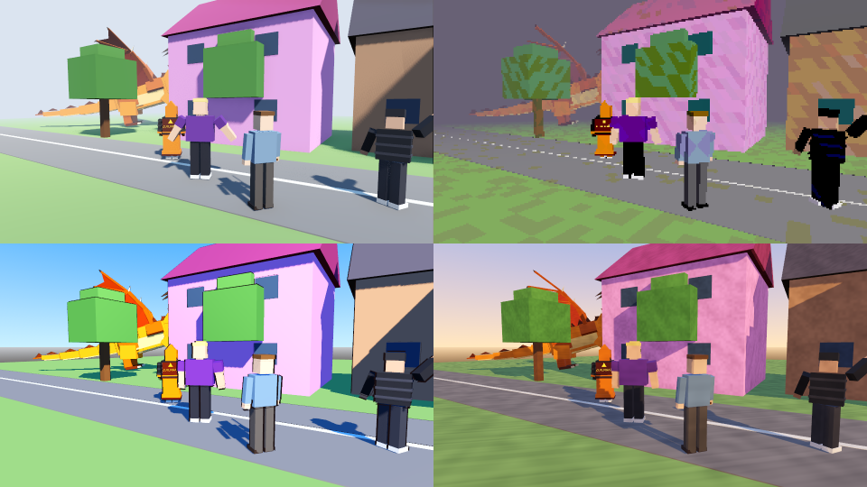

# Elst – Prototype 2

21-11-2026 · ontwerp voor Prototype 2, op basis van de notitie van de eigenaar ("Game idee prototype 2")

Prototype 1 (Fase 0 t/m 12) is de oorspronkelijke visie van *Elst*, van begin tot eind speelbaar. Prototype 2 bouwt daarop verder. Dit document is de bron van waarheid voor Prototype 2; waar het afwijkt van `docs/GDD.md` (het ontwerp van Prototype 1), geldt dit document.

## Doel

1. **Graphics en modellen** in veel meer detail, maar nog steeds low poly. Dit is het belangrijkste en komt in de eerste fases. De precieze stijl kiest de eigenaar uit vier voorstellen (zie *Graphics: vier stijlvoorstellen*).
2. **Personages:** de hoofdpersoon wordt **Gyan**. **Jules** en **Sven** komen erbij als de tweede en derde Elstenaar. Klaas wordt grafisch verbeterd. Dit verandert ook het verhaal.
3. **Bijcontent in de open wereld**, om Elst te vullen: als eerste Klaas' oude motor bij de lege velden naast het OBC Fort. Later volgt meer.

Wat in Prototype 1 werkt (combat, quests, opslaan, dungeons, bazen, geluid), blijft de basis. Prototype 2 verbetert en vult aan; het gooit niets weg zonder reden.

## Verhaal en personages

### De Elstenaars

In Prototype 1 is de speler "een niemand" die aan het eind van Klaas hoort dat hij "een echte Elstenaar" is. In Prototype 2 wordt dat de rode draad: rond Klaas vormt zich een groepje **Elstenaars**, mensen uit Elst die het tegen Amber opnemen.

| # | Elstenaar | Hoe hij erbij komt |
| --- | --- | --- |
| 1 | **Gyan** | De hoofdpersoon. Hij komt in Elst terecht, Klaas neemt hem onder zijn hoede (Quest 1). |
| 2 | **Jules** | Zit opgesloten in een kooi in de Westeraam-dungeon. Met de sleutel van de Vape-koning kan Gyan hem bevrijden. **Optioneel.** |
| 3 | **Sven** | Leidt een OBC-voorpost in de buurt van het OBC Fort en is daar een miniboss. Na zijn nederlaag kies je: overtuig hem om de kant van Klaas te kiezen, of vermoord hem. **Optioneel** (bijquest). |

Jules en Sven zijn allebei optioneel (besluit eigenaar, 21-11-2026): wie ze niet redt of overtuigt, ziet ze verder niet in de game.

De eigenaar werkt de karakterontwikkeling van Gyan, Jules en Sven later verder uit. De teksten hieronder zijn een startpunt.

### Gyan (hoofdpersoon)

- **Uiterlijk** (referentie `docs/reference/Gyan.png`, alleen lokaal): jong, slank, licht getinte huid, donkerbruin, warrig haar van gemiddelde lengte met een pony over het voorhoofd, bruine ogen, een grote, open lach. Een geruit overhemd (blauw-wit) als basiskleding; uitrusting blijft zichtbaar op het model, zoals nu.
- **Rol:** speelbaar personage, vervangt "de speler, een niemand". Klaas en de andere personages noemen hem bij naam.
- **Stille hoofdpersoon** (besluit eigenaar, 21-11-2026): Gyan zegt zelf niets. Anderen praten tegen hem; de keuzes in gesprekken blijven korte opties zonder eigen stem. Ook de zin bij de rand van Elst na het einde ("Waar ga ik heen?...") wordt een gedachte in beeld of een reactie van een ander.

### Jules (tweede Elstenaar)

- **Uiterlijk** (referentie `docs/reference/Jules.png`): lichte huid met sproeten, blond tot rossig, warrig haar met een lange pony, blauwgroene ogen, een sceptische, wat argwanende blik. Een donker groenbruine jas of hoodie.
- **In het verhaal** (besluit eigenaar, 21-11-2026): Jules zit in een kooi in de Westeraam-dungeon. De sleutel krijg je van de Vape-koning (hij laat hem vallen als je hem verslaat). Bevrijden is optioneel.
- **Bevrijd:** een korte scène waarin Jules Gyan op zijn eigen droge manier bedankt. Daarna kom je hem af en toe tegen in de open wereld, waar hij vecht tegen een paar drillers; je kunt hem helpen. Hij staat ook op het feest aan het eind.
- **Niet bevrijd:** Jules komt verder niet in de game voor.

### Sven (derde Elstenaar)

- **Uiterlijk** (referentie `docs/reference/Sven.png`): lichte huid, kort lichtbruin tot donkerblond haar met een zijscheiding, een brede kaak, een uitdagende, pruilende blik. Zwarte hoodie en een grote zwarte koptelefoon om zijn nek of op zijn hoofd.
- **Optioneel** (besluit eigenaar, 21-11-2026): de voorpost is een bijquest; het OBC Fort kan ook zonder Sven.
- **In het verhaal:** Sven leidt een **OBC-voorpost**, een kleiner kamp van het OBC in de buurt van het OBC Fort. Hij is daar een **miniboss** met zijn eigen aanvallen. Na zijn nederlaag ligt hij op de grond en kiest de speler:
  - **Overtuigen:** Sven kiest de kant van Klaas en wordt de derde Elstenaar. Hij komt naar Elst en is later te zien (bij Klaas, op het feest; mogelijk helpt hij in het eindgevecht).
  - **Vermoorden:** Sven is weg. Klaas reageert erop (teleurgesteld of hard), en het einde is iets donkerder: er staan maar twee Elstenaars op het plein.
- De keuze wordt een vlag (`sven_spared` of `sven_killed`) die dialogen, het einde en eventueel de Inwijding beïnvloedt.

### Klaas

Blijft zoals hij is (lang, breed, gespierd, blond, strakke kaak, zonnebril die nooit afgaat, paars en goud), maar krijgt een veel gedetailleerder model (referentie `docs/reference/Klaas_sigma.png`): spiervorm in armen, borst en nek, een kaak en een kuif die kloppen, de gouden ketting, een strak shirt. Hij krijgt nieuwe animaties (flexen, lachen, wijzen) en een eigen stem.

### Wat blijft

Amber de Draak uit Zevenaar, de drie facties en hun bazen, het station, de kerk en het eindgevecht blijven. De spion in de mantel en "plan B" blijven een haak voor later; de eindscène wordt opnieuw gemaakt met de nieuwe personages.

### Nieuwe verloop van de hoofdquests

| # | Quest | Verandering in Prototype 2 |
| --- | --- | --- |
| 1 | Inleiding | Gyan heeft een naam; Klaas noemt hem "de eerste Elstenaar" zodra de tutorial af is. |
| 2 | Station Elst | Geen grote verandering. |
| 3 | Westeraam Getho | De Vape-koning laat de sleutel van Jules' kooi vallen; Jules bevrijden is een optioneel doel. |
| 4 | OBC Elst Fort | Geen verandering; de OBC-voorpost met Sven is een aparte bijquest in de buurt. |
| 5 | Bingo Club | Geen grote verandering. |
| 6 | Amber de Draak | De Elstenaars spelen mee in de scènes; het einde hangt af van Svens lot. |

## Bijcontent in de open wereld

Bijquests krijgen een eigen plek in het questlog (tabbladen *Hoofdquests* en *Bijquests*), een eigen kleur op het kompas en een kleine beloning. Ze zijn optioneel.

### Klaas' oude motor (eerste bijquest)

- Naast de lege velden bij het OBC Fort (zuidwesten van Elst, zie `docs/kaart_elst_spel.png`) staat een roestige, oude motor onder een zeil.
- Klaas herkent hem ("Mijn oude motor! Die dacht ik kwijt te zijn sinds Amber kwam.").
- **Voorstel:** de speler zoekt twee onderdelen in de buurt (bijvoorbeeld een bougie in een kist van de OBC-voorpost en een ketting bij het station), Klaas maakt hem weer heel, en daarna kan Gyan erop rijden: sneller door Elst, met een eigen geluid. Of rijden er echt in komt, beslist de eigenaar.

### Later

De eigenaar voegt meer bijcontent toe. Het systeem van Fase P2-10 is daarvoor gemaakt: nieuwe bijquests zijn alleen data (`QuestData` met een vlag `side_quest`) plus een plek in de wereld.

## Graphics: vier stijlvoorstellen

Alle vier blijven low poly en passen bij de humor van Elst. Ze verschillen in hoe materialen, licht en de nabewerking werken. Fase P2-1 bouwt een **stijllab**: één testscène (een stukje straat met het huis van Klaas, een paar huizen en bomen, Klaas, Gyan, een driller en een stukje van Amber) waarin je met een toets tussen de vier stijlen wisselt. Daarna kiest de eigenaar.

**Voorbeelden:** `docs/style_proposals/` bevat dezelfde scène (Klaas, het huidige spelermodel als stand-in voor Gyan, een driller, een cultist, huizen, bomen, een weg en Amber) in elk van de vier stijlen: `style_a.png` t/m `style_d.png` en alles samen in `styles_sheet.png` (linksboven A, rechtsboven B, linksonder C, rechtsonder D). Gemaakt met `tools/style_preview/render_styles.gd` (`godot --path . -s res://tools/style_preview/render_styles.gd`, met venster). Let op: het zijn nog de modellen van Prototype 1; de voorbeelden laten de stijl zien (materialen, licht, nabewerking). De modellen zelf krijgen in P2-3 t/m P2-6 veel meer detail.

### A. Strak low poly

- **Wat:** vlakke kleuren per vlak (flat shading) op modellen met meer vlakken, schuine randen en ronde vormen. Zachte schaduwen, ambient occlusion (SSAO), een kleurverloop in de lucht, volumetrische mist en een warme zon. De retrofilter gaat standaard uit (blijft een optie).
- **Gevoel:** rustig en modern, zoals *Townscaper* of de lowpoly-landschappen uit *Firewatch*-achtige concept art.
- **Voor:** dicht bij wat we nu hebben; alles blijft zonder texturen, dus onze Python-generators werken door. Goed leesbaar.
- **Tegen:** kan "netjes maar braaf" ogen; leunt zwaar op goed licht en goede kleuren.
- **Werk:** gemiddeld.

### B. Echte PS1-retro

- **Wat:** laag-resolutie texturen (64 tot 128 pixels, met een beperkt palet) op eenvoudige modellen, verspringende vertices (vertex snapping), affiene texturen, sterke mist en dithering. Detail komt uit de texturen, niet uit extra vlakken.
- **Gevoel:** nostalgisch en een beetje vreemd, zoals indiegames die de PlayStation 1 nadoen.
- **Voor:** bouwt voort op de retrofilter van Prototype 1; veel sfeer met weinig vlakken.
- **Tegen:** we moeten veel texturen maken (met een script of met de hand); minder goed leesbaar in gevechten; de humor kan wegvallen in de "creepy" PS1-sfeer.
- **Werk:** groot (texturen).

### C. Toon / cel-shaded low poly (aanbevolen)

- **Wat:** licht in twee of drie harde banden (cel shading), donkere omlijningen rond personages en gebouwen, verzadigde kleuren, een stripachtige lucht. Modellen krijgen meer vorm (spieren van Klaas, gezichten met ogen, wenkbrauwen en mond als eigen vlakken), maar geen texturen.
- **Gevoel:** een speelbare strip, zoals *The Legend of Zelda: The Wind Waker* of *Hi-Fi Rush*, maar dan in blokjes.
- **Voor:** past het best bij de droge humor; personages (Klaas, Gyan, Jules, Sven) worden direct herkenbaar door omlijning en gezichtsuitdrukkingen; eenvoudige vormen zien er bewust uit in plaats van onaf; geen texturen nodig, dus de generators werken door.
- **Tegen:** omlijningen moeten goed afgesteld worden (niet te dik op afstand); de retrofilter moet aangepast worden zodat hij de lijnen niet wegdithert.
- **Werk:** gemiddeld (twee shaders: toon en omlijning).

### D. Handgeschilderd low poly

- **Wat:** low poly modellen met geschilderde kleurverlopen en details in een texture-atlas (een paar grote texturen voor het hele spel), warm licht en weinig nabewerking.
- **Gevoel:** sprookjesachtig en warm, zoals oudere fantasy-MMO's of *Sea of Thieves* in eenvoudiger vorm.
- **Voor:** de meest "af" ogende stijl; veel detail met weinig vlakken.
- **Tegen:** veel tekenwerk voor de texturen; moeilijk consequent te houden met door code gemaakte modellen; elke nieuwe prop vraagt nieuw tekenwerk.
- **Werk:** het grootst.

**Advies:** C, de toon-stijl. Die past bij de humor, maakt de nieuwe personages herkenbaar en werkt met onze manier van modellen maken (scripts, geen texturen). A is een goede tweede keuze als de eigenaar een rustiger beeld wil.

## Techniek voor Prototype 2

- **Modellen:** de Python-generators (`tools/models/model_builder.py`) worden uitgebreid met echte meshes in plaats van alleen dozen: afgeronde en afgeschuinde vormen, getaperde ledematen, gezichten. De meshes worden als `ArrayMesh` in `.tres` of `.res` weggeschreven, zodat ze nog steeds door code ontstaan en later door Blender-modellen vervangen kunnen worden.
- **Rig:** personagemodellen krijgen meer gewrichten: ellebogen, knieën, polsen, enkels, nek en ruggengraat. `HumanoidModel` blijft de animaties in code spelen, met dezelfde actienamen, plus nieuwe (lachen, wijzen, zitten op een motor, in een kooi hangen).
- **Materialen en shaders:** één set gedeelde materialen per stijl (bijvoorbeeld `res://materials/toon/`), een toon-shader en een omlijning (omgekeerde schil of een post-process randdetectie), afgestemd op de retrofilter.
- **Wereld:** wegen worden echte meshes langs splines in plaats van een raster van 1 m; de grond krijgt zachtere overgangen; huizen krijgen types (rijtjeshuis, twee-onder-een-kap, flat, boerderij) en meer detail (ramen, deuren, dakgoten, schuurtjes, schuttingen).
- **Scènes:** het scènesysteem (`Cutscene`) krijgt korte camerapaden, close-ups met gezichtsuitdrukkingen en "blokkades" (waar wie staat), zodat de scènes van Prototype 1 (Klaas valt, het einde, de spion) opnieuw en beter gemaakt kunnen worden.
- **Stemmen:** iedere spreker krijgt een eigen stemblip (toonhoogte en klank), al begonnen in Fase 12 met `DialogueData.voice_pitch`.
- **Saves:** het save-formaat gaat naar versie 2. Advies: saves van Prototype 1 hoeven niet te laden (een nieuw spel), want personages en quests veranderen.

## Fases van Prototype 2

Werkwijze en git-regels blijven zoals in `CLAUDE.md`: één fase is één request en één branch vanaf `Development`, een commit per onderdeel, en mergen na "akkoord" op de testchecklist. De fases zijn genummerd P2-1 en verder.

| Fase | Branch | Inhoud | Klaar als |
| --- | --- | --- | --- |
| P2-0 | `Plan-Prototype-2` | Dit document, de stijlvoorstellen, de fases en de bijgewerkte documenten | De eigenaar is akkoord met het plan |
| P2-1 | `Build-Graphics-Style-Lab` | Een testscène met de vier stijlen naast elkaar (wisselen met een toets): materialen, licht, shaders en een paar voorbeeldmodellen per stijl | De eigenaar heeft een stijl gekozen |
| P2-2 | `Upgrade-Rendering-And-Shaders` | De gekozen stijl overal: gedeelde materialen, shaders, licht, lucht, mist, nabewerking en de retrofilter daarop afgestemd | Elst, een dungeon en een baasgevecht ogen in de nieuwe stijl, zonder modellen te vervangen |
| P2-3 | `Upgrade-Character-Rig-And-Models` | Nieuwe rig met ellebogen en knieën, de mesh-generator voor personages, Gyan, Klaas en de dorpelingen, nieuwe animaties | Gyan en Klaas zien eruit als hun referenties en bewegen beter |
| P2-4 | `Upgrade-Enemy-And-Boss-Models` | Alle vijanden en bazen in de nieuwe stijl: drillers, vape-drillers, kakkers, fatbikers (echte rijhouding, draaiende wielen), opa's en oma's met eigen modellen, rolstoel-oma, cultisten, draakjes, de vier bazen | Elke vijand is van ver herkenbaar |
| P2-5 | `Upgrade-World-And-Roads` | Wegen als meshes, nieuwe huizen en bomen, props, de zes locaties, de grond, de tornado | Elst oogt af, zonder blokkerige wegen |
| P2-6 | `Upgrade-Dungeons` | De vijf dungeons en het huis van Klaas in de nieuwe stijl | Alle interieurs passen bij de rest |
| P2-7 | `Add-Gyan-And-Story-Rework` | Gyan als hoofdpersoon, dialogen en scènes herschreven, de scènes van Prototype 1 opnieuw gemaakt (Klaas valt, het einde, de spion), stemmen per personage | Het hele verhaal klopt met Gyan, van begin tot eind |
| P2-8 | `Add-Jules-Rescue` | Jules en zijn model, de kooi in de Westeraam-dungeon, de bevrijding, Jules in Elst | Jules is te bevrijden en daarna in Elst te vinden |
| P2-9 | `Add-Sven-Outpost-Miniboss` | De OBC-voorpost (nieuwe locatie bij het fort), Sven en zijn model, het minibossgevecht, de keuze (overtuigen of vermoorden) en de gevolgen | Beide keuzes zijn te spelen en hebben gevolgen tot en met het einde |
| P2-10 | `Add-Side-Quests-And-Klaas-Motorbike` | Bijquests in het questlog en op het kompas, Klaas' oude motor als eerste bijquest (en rijden, als de eigenaar dat wil) | De motor is te vinden, te maken en (eventueel) te berijden |
| P2-11 | `Polish-Prototype-2` | Balans, geluid en muziek bijwerken, bugfixes, laadschermen, export | Prototype 2 is van begin tot eind speelbaar zonder blokkerende bugs |

**Volgorde:** eerst de graphics (P2-1 t/m P2-6), zoals de eigenaar wil. Het verhaal (P2-7) komt daarna, omdat de nieuwe scènes de nieuwe modellen nodig hebben. Jules, Sven en de motor (P2-8 t/m P2-10) bouwen daarop voort.

## Open beslissingen voor de eigenaar

1. **Stijl:** welke van de vier stijlen (na het stijllab in P2-1)? Advies: C, de toon-stijl.
2. ~~Gyan~~: **besloten**, een stille hoofdpersoon.
3. ~~Jules~~: **besloten**, optioneel; sleutel van de Vape-koning; daarna af en toe in de open wereld tegen drillers.
4. **Sven:** **besloten** dat hij optioneel is (bijquest). Nog open: wat doen overtuigen en vermoorden precies (meevechten tegen Amber, op het feest, een ander einde)?
5. **De motor:** alleen vinden en laten zien, of echt rijden? Met onderdelen zoeken? Advies: wel rijden, met twee onderdelen.
6. **Saves:** saves van Prototype 1 vervallen (advies), of omzetten?
7. **Schaal van Elst:** wegen breder en huizen hoger maken (dan schuift de wereld wat), of de schaal houden?
8. **Controller:** in Prototype 2 of later?
9. **De spion en plan B:** in Prototype 2 verder uitwerken of bewaren voor later?

## Overgenomen punten uit Prototype 1

Uit `docs/PROGRESS.md` (*Verzamelde punten voor Prototype 2*), nu ingedeeld bij de fases:

- Huizen, bomen en props mooier → P2-5.
- Blokkerige paden en wegen (raster van 1 m) → P2-5.
- Smalle straten en lage huizen → P2-5 (zie beslissing 7).
- Fatbikers en het fatbike-kindje: rijhouding en draaiende wielen → P2-4.
- Scènes opnieuw maken na de grafische overhaul, ook de eindscène met de spion → P2-7.
- Stemgeluidjes per personage → P2-7.
- Controller-ondersteuning → beslissing 8.
- Bijquests → P2-10.
- Eigen modellen voor de opa's en oma's, en de rolstoel-oma met buigende benen en draaiende wielen → P2-4.
